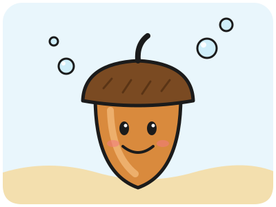
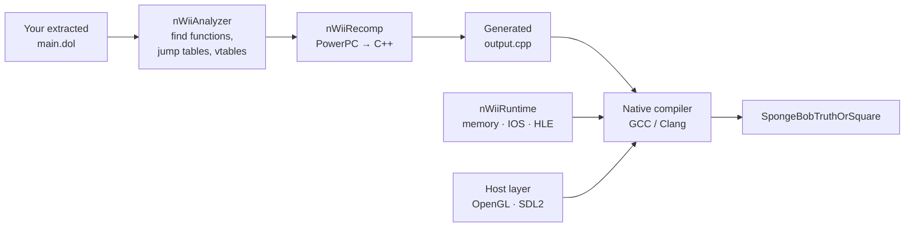

<div align="center">



# Ocean Squirrel

**SpongeBob's Truth or Square** (Wii · `R8IE78`), running natively on PC.<br>
The game's PowerPC code is translated to C++ ahead of time and compiled for your CPU. No emulator, no JIT.


[](https://github.com/BlackLineInteractive/NWiiRecomp)
[](LICENSE)

[Status](#status) · [How it works](#how-it-works) · [Getting started](#getting-started) · [Engineering notes](#engineering-notes) · [Roadmap](#roadmap) · [Contributing](CONTRIBUTING.md)

<sub>Sister project of <a href="https://github.com/santiagoarce-rgb/OceanCrab"><b>🦀 Ocean Crab</b></a>, the same game's PSP version, already playable start to finish.</sub>

</div>

---

## Why

Ocean Squirrel takes your own copy of the Wii game and turns its `main.dol` into a standalone native program. The [NWiiRecomp](https://github.com/BlackLineInteractive/NWiiRecomp) HLE runtime stands in for the Wii's OS, IOS and hardware. Graphics go through OpenGL 4.6, windowing and input through SDL2.

The goal is the same as [Ocean Crab](https://github.com/santiagoarce-rgb/OceanCrab)'s: a full PC port with enhancements, quality-of-life options and, eventually, **co-op**. The Wii version is the higher-fidelity release of the game, so it is the natural long-term target.

> [!IMPORTANT]
> This repository contains **no** game code, assets, disc images or Nintendo/THQ binaries. You need your own legally obtained copy of the game. See [Legal](#legal).

> [!NOTE]
> For now this repository is the project's **log and documentation**. The recompiler patches and runtime changes live in a local NWiiRecomp checkout and have not been published yet. The project started as a Ghidra study of the PSP version; those notes are in [`docs/archive/`](docs/archive/).

## Status

> [!WARNING]
> **Boots, but no frames yet.** The game gets through the Wii OS and IOS init and reaches its main loop, where it waits for a VI retrace that never arrives. See [Current blocker](#current-blocker-no-vi-retrace-handler).

```text
Boot progress  [██████████████████████░░░]  ~88%
```

| Area | | Notes |
|---|:---:|---|
| Analysis | ✅ | `main.dol` parsed, 25,352 PowerPC functions found |
| Code generation | ✅ | One generated `output.cpp`, about 11M lines |
| Native build | ✅ | A clean build takes about 46 min |
| Disc / FST | ✅ | `boot.bin` (`R8IE78`) parsed, FST loaded |
| Video init | ✅ | OpenGL 4.6 context, EFB framebuffer, SDL2 window |
| Wii OS boot | ✅ | `Revolution OS / Kernel built : Feb 27 2009` |
| IOS & IPC | ✅ | `/dev/di`, `/dev/fs`, `/dev/es`, `/dev/stm`, `/dev/usb`, sync + async; IRQ 27 dispatching |
| IOS state machine | ⚠️ | Forced past with a workaround; see [notes](#ios-state-machine-wait-at-0x805189b0) |
| Paired singles | ⚠️ | `psq_lx` / `psq_stx` added as a local recompiler patch, not upstreamed |
| **VI / frame counter** | ❌ | **Blocker.** Main loop waits forever at `0x8050E604` |
| Rendering | ⏳ | Waiting on the VI blocker |
| Audio, input, saving | ⏳ | Not started |

### Current blocker: no VI retrace handler

The game reaches its main loop and then busy-waits for a frame counter that never changes:

```c
// spin inside func_8050E590, PC 0x8050E604
uint32_t start = r3;
do {
    r0 = read_u32(r31 + 27656) & 0x7FFFFFFF;   // global frame counter (offset 0x6C08)
} while (r0 == start);
```

That counter is normally advanced once per frame by the vertical-retrace (VI) interrupt path.

- The game itself never unmasks VI. Its writes to `PI_INTMR` (`0xCC003004`) are `0xF0`, `0xF8` and `0x40F8`. Bit 8 (`0x100`, VI) never appears, and neither do the PE bits (`0x200`, `0x400`).
- As an experiment, the runtime was patched to force VI unmasked and to fire a retrace periodically. The VI interrupt now shows up as pending (`INTSR = 0x100`), **but the game still spins.**
- The reason is that `__OSInterruptTable[24]` (the VI slot, at `0x800030A0`) is **0**. No retrace handler was ever registered, so delivering the interrupt does nothing.

**Working theory:** the SDK's real VI/GX initialization (`VIInit` / `GXInit`) either never runs or fails partway. Normally that code registers `__VIRetraceHandler` and unmasks VI and PE itself. The signature database does not recognize these functions in this DOL, so they have no names to hook.

**Next steps**

1. Find the game's `VIInit` without symbols: look for writes to `0x800030A0`, or for calls to `__OSSetInterruptHandler` with `r3 = 24`.
2. Find who writes `+0x6C08(r31)`. That is most likely a post-retrace callback.
3. Trace whether that code runs. If it never does, find what stalls initialization first (one thread is parked on a wait queue).
4. Remove the forced-unmask hacks once the real init path works.

## How it works



- **Static recompilation:** every Broadway (PowerPC 750CL) function in `main.dol` becomes a C++ function, including paired-singles math.
- **HLE runtime:** IOS devices (`/dev/di`, `/dev/fs`, `/dev/es`, …), the IPC interface, interrupts and MMIO (VI, PI, DI, SI, EXI) are implemented on the host instead of emulated cycle by cycle.
- **Your files, your build:** the generated code is derived from your own copy and is never distributed.

## Getting started

### Requirements

- CMake 3.20+ and a C++20 compiler (GCC or Clang)
- SDL2 and an OpenGL 4.6 driver

<details>
<summary><b>Arch Linux / CachyOS</b></summary>

```bash
sudo pacman -S --needed base-devel cmake sdl2 git
```
</details>

### 1. Prepare your game files

Extract your disc so you have a directory with `sys/` (containing `main.dol` and `boot.bin`) and `files/`.

### 2. Build NWiiRecomp

```bash
git clone https://github.com/BlackLineInteractive/NWiiRecomp.git
cd NWiiRecomp
cmake -B build
cmake --build build -j"$(nproc)"
```

### 3. Configure

Create `recomp_config.toml` in the NWiiRecomp root:

```toml
project_name       = "SpongeBobTruthOrSquare"
input_game_dir     = "/path/to/extracted/game"   # contains sys/ and files/
output_dir         = "build/recompiled"
runtime_source_dir = "nWiiRuntime"
```

### 4. Recompile and build

```bash
./build/nWiiRecomp/nwiirecomp recomp_config.toml

cd build/recompiled
cmake -B build -DCMAKE_BUILD_TYPE=Release -DSDL_PIPEWIRE=OFF -DCMAKE_POLICY_VERSION_MINIMUM=3.5
cmake --build build -j"$(nproc)"
```

The first build takes about **46 minutes**, mostly compiling `output.cpp`. After that, runtime-only changes rebuild in seconds.

### 5. Run

```bash
./build/SpongeBobTruthOrSquare "/path/to/extracted/game"
```

<details>
<summary><b>Debugging environment variables</b></summary>

| Variable | Effect |
|---|---|
| `NWII_SAMPLE=1` | Periodic PC samples, heartbeat thread dumps, IRQ/exception traces |
| `NWII_HEADLESS=1` | Run without a window (log only) |
| `NWII_TRACE_CALLS=1` | Log every recompiled function entry (very verbose) |
| `NWII_LOOPTRACE=0xADDR` | Trace executions of one PC |
| `NWII_PEEK=0xADDR,N` | Dump `N` words at `ADDR` on every heartbeat |
| `NWII_VITRACE=1` | Log VI interrupt triggers |
| `SDL_VIDEODRIVER=x11` | Force X11 under Wayland |
</details>

## Engineering notes

<details>
<summary><b>IRQ 27 was working all along</b></summary>

Early on, IRQ 27 dispatches crashed with `SIGSEGV`. Wrapping `run_game()` in a `setjmp` loop in `cpu_thread_func` (`main.cpp`) fixed it, because the exception path can now `longjmp` back into the dispatcher.

After that, the logs suggested that IRQ 27 still was not firing. That turned out to be a logging artifact:

```cpp
static uint32_t vi_dispatch_count = 0;
if (os_intr != 24 && (vi_dispatch_count++ % 256) == 0) {
    std::cout << "[HLE PI] Dispatching interrupt " ...;
}
```

This prints only 1 dispatch in 256. With the rate limit removed, the log shows **16 dispatches** during boot.

**Lesson:** make sure your instrumentation is actually in the binary you are running.
</details>

<details>
<summary><b>IOS state-machine wait at <code>0x805189B0</code></b></summary>

#### IOS state-machine wait at `0x805189B0`

Before starting WPAD/PAD, the game waits for an IOS state byte to reach `5` (ready):

```c
while (read_u8(0x807D43E6) != 5) {   // state struct 0x807D3D98 + 1614 (0x64E)
    /* yield at 0x800075C0 is a bare `blr` */
}
```

The `0 → 5` transition depends on asynchronous callbacks from the Bluetooth stack (`/dev/usb/oh1/57e/305`). Those never arrive, because the HLE `IOCTLV` returns `0x8FFFFFFF`.

**Workaround:** after 2000 polls, force the byte to `5`. This is a manual edit to the generated `output.cpp`, inside `func_805213CC`:

```cpp
ctx.gpr[3] = ctx.mmu.read8(ctx.gpr[3] + 1614);
{ static uint64_t force = 0;
  if (++force > 2000 && ctx.gpr[3] != 5) {
      ctx.mmu.write8(0x807D43E6, 5);
      ctx.gpr[3] = 5;
  } }
```

Regenerating the code wipes this edit. The proper fix is a Bluetooth (`oh1`) HLE that completes those requests.
</details>

<details>
<summary><b>HLE coverage used by this game</b></summary>

| Component | What it does |
|---|---|
| **ES** (ETicket Services) | Returns a valid title ID and `TicketView` data |
| **DI** | Answers `DVDLowInquiry` and reads from the extracted disc |
| **IPC** (`0xCD000000`) | `PPCMSG` / `PPCCTRL` / `ARMMSG` / `ARMCTRL` registers, with replies delivered as IRQ 27 |
| **Callback dispatcher** | Runs async IOS callbacks on the guest thread |
</details>

<details>
<summary><b>Pitfalls</b></summary>

- **Two copies of the runtime.** The generated project in `build/recompiled/` builds against `build/recompiled/nWiiRuntime/`, not against the top-level `nWiiRuntime/`. Editing the top-level copy does nothing until the files are copied over. The reverse also bites: `build/` is git-ignored, so work done only in the generated copy is not version-controlled, and the recompiler overwrites it when it regenerates. To check which copy you are running:

  ```sh
  stat -c '%y %n' nWiiRuntime/src/hle/ios.cpp build/recompiled/nWiiRuntime/src/hle/ios.cpp
  strings build/recompiled/build/SpongeBobTruthOrSquare | grep -c "<your new log string>"
  ```

- **Rate-limited logs.** Guards like `if ((n++ % N) == 0)` hide most events. Remove them while you debug.
- **Edits to `output.cpp` are temporary.** Every regeneration replaces it. Prefer `[hle_hooks]` in the TOML or runtime-side fixes, and write down any manual edit so it can be reapplied.
</details>

## Roadmap

| Phase | | Goal |
|---|:---:|---|
| **Bring-up** | 🚧 | Done: recompile, native build, Wii OS / IOS / DI / ES boot, SDL2 + OpenGL context, IRQ 27. Left: **VI retrace and frame counter** ← current, first frame in the EFB, title screen, menus, gameplay |
| 1 · Correctness | 🔭 | Bluetooth / Wii Remote HLE (replaces the IOS workaround), audio (AI/DSP), saving, upstream the paired-singles and runtime patches |
| 2 · Understanding | 🔭 | Symbol map and game structures, sharing what was already learned in [Ocean Crab](https://github.com/santiagoarce-rgb/OceanCrab) (same game, different port) |
| 3 · Enhancements | 🔭 | In-game options menu, high resolution, widescreen, 60 FPS |
| 4 · Co-op | 🔭 | Networked co-op, following the Ocean Crab design |

## Contributing

Help is very welcome, especially with **finding `VIInit` / `GXInit` in this DOL**, IOS Bluetooth HLE, and GX rendering once frames start flowing. Read [`CONTRIBUTING.md`](CONTRIBUTING.md) first. It covers the commit style and the rule about never committing generated code or game data.

General-purpose fixes to the recompiler and runtime are intended to go back upstream to [NWiiRecomp](https://github.com/BlackLineInteractive/NWiiRecomp).

## A note from the developer

I'm a full-time university student in a field that has nothing to do with programming. AI tools have helped me close a lot of technical gaps and learn faster. This is a labor of love, driven by nostalgia for a childhood favorite, plus curiosity and fun. Thanks for checking it out!

## Legal

Ocean Squirrel does **not** include any copyrighted game code, assets, disc images or executables. You must own the game and prepare its files yourself. The generated C++ is derived from your own copy and is never distributed.

*SpongeBob SquarePants* and all related properties are trademarks of their respective owners (Nickelodeon / Paramount, THQ, Heavy Iron Studios, Nintendo). This is an unofficial fan project made for preservation and education. It is not affiliated with or endorsed by the rights holders.

## Credits

Ocean Squirrel stands on the shoulders of:

- [**NWiiRecomp**](https://github.com/BlackLineInteractive/NWiiRecomp) by Blackline Interactive: the recompiler and runtime
- [**Dolphin**](https://github.com/dolphin-emu/dolphin): documentation of the Wii's IPC, PI, VI and IOS behavior
- [**WiiBrew**](https://wiibrew.org) and [**YAGCD**](https://hitmen.c02.at/files/yagcd/): hardware references
- **libogc / devkitPro**: references for the Wii kernel and syscalls
- [**Ocean Crab**](https://github.com/santiagoarce-rgb/OceanCrab): the PSP sibling, and the template for this project's goals

## License

Documentation in this repository: [MIT](LICENSE). NWiiRecomp ships under its own license; see its repository.
