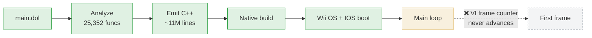

<div align="center">

# 🐿️🌊 Ocean-Squirrel

### Native PC port of *SpongeBob SquarePants: Truth or Square* (Wii) via static recompilation

<p>
  
  
  
  
  <a href="https://github.com/BlackLineInteractive/NWiiRecomp"></a>
  <a href="LICENSE"></a>
  
</p>

**[Status](#-status)** · **[Current blocker](#-current-blocker-no-vi-retrace-handler)** · **[Engineering notes](#-engineering-notes)** · **[Building](#-building)** · **[Roadmap](#%EF%B8%8F-roadmap)**

</div>

---

Ocean-Squirrel translates the game's PowerPC (Broadway) code into C++ and runs it **natively on Linux**, using the [NWiiRecomp](https://github.com/BlackLineInteractive/NWiiRecomp) recompiler and its HLE runtime. No emulator, no interpreter loop — just the game's own code compiled for your PC.

| | |
| --- | --- |
| 🎮 **Game** | *SpongeBob SquarePants: Truth or Square* — Wii, NTSC-U, `R8IE78` |
| 🛠️ **Toolchain** | [NWiiRecomp](https://github.com/BlackLineInteractive/NWiiRecomp) (PPC → C++) |
| 🐧 **Host** | Linux x86_64 (developed on CachyOS), GCC, CMake, SDL2, OpenGL 4.6 |
| 📍 **Status** | Boots through the Wii OS and IOS init, reaches the main loop, **no frames rendered yet** |

> [!NOTE]
> This repository is the project's **log and documentation**. The recompiler patches and runtime changes currently live in a local NWiiRecomp checkout and have not been published yet.
>
> The project started as a Ghidra-based study of the PSP version and moved to a Wii static recompilation. The old PSP notes are kept in [`docs/archive/`](docs/archive/).

> [!IMPORTANT]
> This repository contains **no** game assets, disc images, or Nintendo/THQ binaries. You need your own legally obtained copy of the game. All trademarks belong to their respective owners (Nickelodeon / Paramount, THQ, Heavy Iron Studios, Nintendo).

---

## 📊 Status

```text
Boot progress  [██████████████████████░░░]  ~88%
```



| Stage | State | Notes |
| --- | :---: | --- |
| Analysis of `main.dol` | ✅ | 25,352 PowerPC functions found |
| C++ emission | ✅ | One generated `output.cpp`, about 11M lines |
| Native build & link | ✅ | A clean build takes about 46 min |
| Disc / FST loading | ✅ | `boot.bin` (`R8IE78`) parsed, FST loaded |
| Video init | ✅ | OpenGL 4.6 context, EFB framebuffer, SDL2 window |
| Wii OS boot | ✅ | `Revolution OS / Kernel built : Feb 27 2009` |
| IOS devices & IPC | ✅ | `/dev/di`, `/dev/fs`, `/dev/es`, `/dev/stm`, `/dev/usb`, sync + async |
| IPC interrupt (IRQ 27) | ✅ | Dispatching correctly; see [notes](#irq-27-was-working-all-along) |
| IOS state-machine wait | ⚠️ | **Workaround** — forced past; see [notes](#ios-state-machine-wait-at-0x805189b0) |
| Paired singles (`psq_lx` / `psq_stx`) | ⚠️ | **Local patch** — added to the recompiler, not yet upstreamed |
| **VI / frame counter** | ❌ | **Blocker** — main loop waits forever at `0x8050E604` |
| First rendered frame | ⏳ | Waiting on the VI blocker |

---

## 🚧 Current blocker: no VI retrace handler

The game reaches its main loop and then busy-waits for a frame counter that never changes:

```c
// spin inside func_8050E590, PC 0x8050E604
uint32_t start = r3;
do {
    r0 = read_u32(r31 + 27656) & 0x7FFFFFFF;   // global frame counter (offset 0x6C08)
} while (r0 == start);
```

That counter is normally advanced once per frame by the vertical-retrace (VI) interrupt path.

**🔎 What the logs show**

- The game itself never unmasks VI. Its writes to `PI_INTMR` (`0xCC003004`) are `0xF0`, `0xF8` and `0x40F8`. Bit 8 (`0x100`, VI) never appears, and neither do the PE bits (`0x200`, `0x400`).
- As an experiment, the runtime was patched to force VI unmasked and to fire a retrace periodically. The VI interrupt now shows up as pending (`INTSR = 0x100`), **but the game still spins.**
- The reason is that `__OSInterruptTable[24]` (the VI slot, at `0x800030A0`) is **0**. No retrace handler was ever registered, so delivering the interrupt does nothing.

> [!TIP]
> **Working theory:** the real VI/GX initialization of the SDK (`VIInit` / `GXInit`) either never runs or fails partway. Normally that code registers `__VIRetraceHandler` and unmasks VI and PE itself. The signature database does not recognize these functions in this DOL, so they have no names to hook.

**🧭 Next steps**

1. Find the game's `VIInit` without symbols: look for writes to `0x800030A0`, or for calls to `__OSSetInterruptHandler` with `r3 = 24`.
2. Find who writes `+0x6C08(r31)`. That is most likely a post-retrace callback.
3. Trace whether that code runs. If it never does, find what stalls initialization first (one thread is parked on a wait queue).
4. Remove the forced-unmask hacks once the real init path works.

---

## 📓 Engineering notes

<details>
<summary><b>IRQ 27 was working all along</b></summary>

### IRQ 27 was working all along

Early on, IRQ 27 dispatches crashed with `SIGSEGV`. Wrapping `run_game()` in a `setjmp` loop in `cpu_thread_func` (`main.cpp`) fixed it, because the exception path can now `longjmp` back into the dispatcher.

After that, the logs suggested that IRQ 27 still was not firing. That turned out to be a logging artifact:

```cpp
static uint32_t vi_dispatch_count = 0;
if (os_intr != 24 && (vi_dispatch_count++ % 256) == 0) {
    std::cout << "[HLE PI] Dispatching interrupt " ...;
}
```

This prints only 1 dispatch in 256. With the rate limit removed, the log shows **16 dispatches** during boot.

**Lesson:** make sure your instrumentation is actually in the binary you are running. See [Pitfalls](#%EF%B8%8F-pitfalls).

</details>

<details>
<summary><b>IOS state-machine wait at <code>0x805189B0</code></b></summary>

### IOS state-machine wait at `0x805189B0`

Before starting WPAD/PAD, the game waits for an IOS state byte to reach `5` (ready):

```c
while (read_u8(0x807D43E6) != 5) {   // state struct 0x807D3D98 + 1614 (0x64E)
    /* yield at 0x800075C0 is a bare `blr` */
}
```

The `0 → 5` transition depends on asynchronous callbacks from the Bluetooth stack (`/dev/usb/oh1/57e/305`). Those never arrive, because the HLE `IOCTLV` returns `0x8FFFFFFF`.

**Workaround:** after 2000 polls, force the byte to `5`. This is a manual edit to the generated `output.cpp`, inside `func_805213CC`:

```cpp
ctx.gpr[3] = ctx.mmu.read8(ctx.gpr[3] + 1614);
{ static uint64_t force = 0;
  if (++force > 2000 && ctx.gpr[3] != 5) {
      ctx.mmu.write8(0x807D43E6, 5);
      ctx.gpr[3] = 5;
  } }
```

> [!WARNING]
> Regenerating the code wipes this edit. The proper fix is a Bluetooth (`oh1`) HLE that completes those requests.

</details>

<details>
<summary><b>HLE coverage used by this game</b></summary>

### HLE coverage used by this game

| Component | What it does |
| --- | --- |
| **ES** (ETicket Services) | Returns a valid title ID and `TicketView` data |
| **DI** | Answers `DVDLowInquiry` and reads from the extracted disc |
| **IPC** (`0xCD000000`) | `PPCMSG` / `PPCCTRL` / `ARMMSG` / `ARMCTRL` registers, with replies delivered as IRQ 27 |
| **Callback dispatcher** | Runs async IOS callbacks on the guest thread |

</details>

---

## ⚠️ Pitfalls

- **Two copies of the runtime.** The generated project in `build/recompiled/` builds against `build/recompiled/nWiiRuntime/`, not against the top-level `nWiiRuntime/`. Editing the top-level copy does nothing until the files are copied over. The reverse also bites: `build/` is git-ignored, so work done only in the generated copy is not version-controlled, and the recompiler overwrites it when it regenerates. To check which copy you are running:

  ```sh
  stat -c '%y %n' nWiiRuntime/src/hle/ios.cpp build/recompiled/nWiiRuntime/src/hle/ios.cpp
  strings build/recompiled/build/SpongeBobTruthOrSquare | grep -c "<your new log string>"
  ```

- **Rate-limited logs.** Guards like `if ((n++ % N) == 0)` hide most events. Remove them while you debug.
- **Edits to `output.cpp` are temporary.** Every regeneration replaces it. Prefer `[hle_hooks]` in the TOML or runtime-side fixes, and write down any manual edit (like the one above) so it can be reapplied.

---

## 🔨 Building

<details open>
<summary><b>Prerequisites (Arch / CachyOS)</b></summary>

```sh
sudo pacman -S --needed base-devel cmake sdl2 git
```

</details>

**1. Build NWiiRecomp**

```sh
git clone https://github.com/BlackLineInteractive/NWiiRecomp.git
cd NWiiRecomp
cmake -B build
cmake --build build -j"$(nproc)"
```

**2. Configure** — create `recomp_config.toml` in the NWiiRecomp root:

```toml
project_name       = "SpongeBobTruthOrSquare"
input_game_dir     = "/path/to/extracted/game"   # contains sys/ and files/
output_dir         = "build/recompiled"
runtime_source_dir = "nWiiRuntime"
```

**3. Recompile and build**

```sh
./build/nWiiRecomp/nwiirecomp recomp_config.toml

cd build/recompiled
cmake -B build -DCMAKE_BUILD_TYPE=Release -DSDL_PIPEWIRE=OFF -DCMAKE_POLICY_VERSION_MINIMUM=3.5
cmake --build build -j"$(nproc)"
```

> [!NOTE]
> The first build takes about **46 minutes**, mostly compiling `output.cpp`. After that, runtime-only changes rebuild in seconds.

**4. Run**

```sh
./build/SpongeBobTruthOrSquare "/path/to/extracted/game"
```

<details>
<summary><b>🧰 Debug environment variables</b></summary>

| Variable | Effect |
| --- | --- |
| `NWII_SAMPLE=1` | Periodic PC samples, heartbeat thread dumps, IRQ/exception traces |
| `NWII_HEADLESS=1` | Run without a window (log only) |
| `NWII_TRACE_CALLS=1` | Log every recompiled function entry (very verbose) |
| `NWII_LOOPTRACE=0xADDR` | Trace executions of one PC |
| `NWII_PEEK=0xADDR,N` | Dump `N` words at `ADDR` on every heartbeat |
| `NWII_VITRACE=1` | Log VI interrupt triggers |
| `SDL_VIDEODRIVER=x11` | Force X11 under Wayland |

</details>

---

## 🗺️ Roadmap

- [x] Recompile `main.dol` to C++
- [x] Native build and link
- [x] Boot the Wii OS, IOS, DI, and ES
- [x] SDL2 window and OpenGL context
- [x] IRQ 27 (IPC) dispatch
- [x] Get past the IOS state-machine wait (workaround)
- [ ] **Register the VI retrace handler and advance the frame counter** ← current
- [ ] First frame in the EFB
- [ ] Title screen, menus, gameplay
- [ ] Bluetooth / Wii Remote HLE (replaces the IOS workaround)
- [ ] Audio (AI/DSP)
- [ ] Publish the runtime/recompiler patches
- [ ] Stretch goal: co-op

---

## 💛 A note from the developer

> I'm a full-time university student in a field that has nothing to do with programming. AI tools have helped me close a lot of technical gaps and learn faster. This is a labor of love, driven by nostalgia for a childhood favorite, plus curiosity and fun. Thanks for checking it out!

## 🙏 Acknowledgments

- **[NWiiRecomp](https://github.com/BlackLineInteractive/NWiiRecomp)** by Blackline Interactive — the recompiler and runtime this project builds on.
- **[Dolphin](https://github.com/dolphin-emu/dolphin)** — documentation of the Wii's IPC, PI, VI, and IOS behavior.
- **[WiiBrew](https://wiibrew.org)** and **[YAGCD](https://hitmen.c02.at/files/yagcd/)** — hardware references.
- **libogc / devkitPro** — references for the Wii kernel and syscalls.

## 📄 License

The documentation in this repository is released under the [MIT License](LICENSE). NWiiRecomp ships under its own license; see its repository.

<div align="center">
<sub>Made with 🍍 and way too many log files.</sub>
</div>
