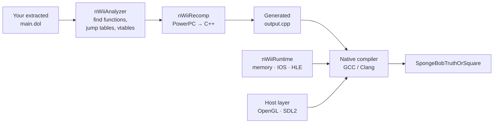

<div align="center">


# Ocean Squirrel

**SpongeBob's Truth or Square** (Wii · `R8IE78`), running natively on PC.<br>
The game's PowerPC code is translated to C++ ahead of time and compiled for your CPU. No emulator, no JIT.


[](https://github.com/BlackLineInteractive/NWiiRecomp)
[](LICENSE)

[Status](#status) · [How it works](#how-it-works) · [Getting started](#getting-started) · [Engineering notes](#engineering-notes) · [Roadmap](#roadmap) · [Contributing](CONTRIBUTING.md)

<sub>Sister project of <a href="https://github.com/santiagoarce-rgb/OceanCrab"><b>🦀 Ocean Crab</b></a>, the same game's PSP version, already playable start to finish.</sub>

</div>

---

## Why

Ocean Squirrel takes your own copy of the Wii game and turns its `main.dol` into a standalone native program. The [NWiiRecomp](https://github.com/BlackLineInteractive/NWiiRecomp) HLE runtime stands in for the Wii's OS, IOS and hardware. Graphics go through OpenGL 4.6, windowing and input through SDL2.

The goal is the same as [Ocean Crab](https://github.com/santiagoarce-rgb/OceanCrab)'s: a full PC port with enhancements, quality-of-life options and, eventually, **co-op**. The Wii version is the higher-fidelity release of the game, so it is the natural long-term target.

> [!IMPORTANT]
> This repository contains **no** game code, assets, disc images or Nintendo/THQ binaries. You need your own legally obtained copy of the game. See [Legal](#legal).

> [!NOTE]
> For now this repository is the project's **log and documentation**. The recompiler patches and runtime changes live in a local NWiiRecomp checkout and have not been published yet. The project started as a Ghidra study of the PSP version; those notes are in [`docs/archive/`](docs/archive/).

## Status

> [!WARNING]
> **The engine runs and talks to the GPU, but no frames yet.** The game gets through OS, IOS, audio, DSP and Wii Remote init, starts its engine threads, enables the GX interrupts and streams hundreds of thousands of commands into the GX FIFO. None of them are recognized as draws yet. See [Current blocker](#current-blocker-gx-commands-but-no-draws).

```text
Boot progress  [████████████████████████░]  ~95%
```

| Area | | Notes |
|---|:---:|---|
| Analysis | ✅ | `main.dol` parsed, 25,352 PowerPC functions found |
| Code generation | ✅ | One generated `output.cpp`, about 11M lines |
| Native build | ✅ | A clean build takes about 48 min and ~20 GB of RAM |
| Disc / FST | ✅ | `boot.bin` (`R8IE78`) parsed, FST loaded, `boot.ini` / `sb09.ini` found |
| Video init | ✅ | OpenGL 4.6 context, EFB framebuffer, SDL2 window |
| Wii OS boot | ✅ | `Revolution OS / Kernel built : Feb 27 2009` |
| IOS & IPC | ✅ | `/dev/di`, `/dev/fs`, `/dev/es`, `/dev/stm`, `/dev/usb`, sync + async; IRQ 27 dispatching |
| Wii Remote (WPAD) init | ⚠️ | IOS state byte forced to ready with `NWII_FORCE_WPAD_READY=1`; see [notes](#ios-state-machine-wait-at-0x805189b0) |
| Paired singles | ⚠️ | `psq_lx` / `psq_stx` added as a local recompiler patch, not upstreamed |
| Audio interface (AI) | ✅ | `AIInit` passes since the AI mirror fix; see [notes](#the-frame-counter-that-was-an-audio-counter) |
| DSP / AX microcode | ✅ | Task boots, DSP and AI-DMA interrupts fire; see [notes](#a-null-vi-handler-starved-the-dsp) |
| Engine start | ✅ | No more null-pointer calls since the `lwarx`/`stwcx.` fix; see [notes](#an-off-by-one-byte-refcount) |
| GX FIFO | 🚧 | ~700k FIFO writes in 3 minutes, GX interrupts (CP, PE token, PE finish) unmasked |
| **Draw calls** | ❌ | **Blocker.** The FIFO parser has not recognized a single draw yet |
| Rendering | ⏳ | Waiting on the draw blocker |
| Input, saving | ⏳ | Not started |

### Current blocker: GX commands but no draws

The game now enables `PI_INTMR = 0x4FF8` (CP, PE token and PE finish on top of VI, DSP and IPC) and writes to the GX FIFO continuously, but the runtime's GX profiler keeps reporting `draws_snap=0`.

**Next steps**

1. Dump the first few thousand bytes of the FIFO and decode them by hand: are they BP/XF/CP register loads only, or are there primitive (`0x80`–`0xB8`) or display-list (`0x40`) commands the parser skips?
2. Check that the CPU-side FIFO pointers (`CP` base / end / write pointer at `0xCC00xxxx`) match what the game set up, so commands are read from the right place.
3. Find the game's frame loop and see whether it waits on a PE token or draw-done that never arrives.

## How it works



- **Static recompilation:** every Broadway (PowerPC 750CL) function in `main.dol` becomes a C++ function, including paired-singles math.
- **HLE runtime:** IOS devices (`/dev/di`, `/dev/fs`, `/dev/es`, …), the IPC interface, interrupts and MMIO (VI, PI, DI, SI, EXI) are implemented on the host instead of emulated cycle by cycle.
- **Your files, your build:** the generated code is derived from your own copy and is never distributed.

## Getting started

### Requirements

- CMake 3.20+ and a C++20 compiler (GCC or Clang)
- SDL2 and an OpenGL 4.6 driver

<details>
<summary><b>Arch Linux / CachyOS</b></summary>

```bash
sudo pacman -S --needed base-devel cmake sdl2 git
```
</details>

### 1. Prepare your game files

Extract your disc so you have a directory with `sys/` (containing `main.dol` and `boot.bin`) and `files/`.

> [!TIP]
> Dolphin's *Extract Entire Disc* puts the game partition under `DATA/`. Point the runner (and `input_game_dir`) at that `DATA/` folder, otherwise the game cannot find `boot.ini` and its other data files.

### 2. Build NWiiRecomp

```bash
git clone https://github.com/BlackLineInteractive/NWiiRecomp.git
cd NWiiRecomp
cmake -B build
cmake --build build -j"$(nproc)"
```

### 3. Configure

Create `recomp_config.toml` in the NWiiRecomp root:

```toml
project_name       = "SpongeBobTruthOrSquare"
input_game_dir     = "/path/to/extracted/game"   # contains sys/ and files/
output_dir         = "build/recompiled"
runtime_source_dir = "nWiiRuntime"
```

### 4. Recompile and build

```bash
./build/nWiiRecomp/nwiirecomp recomp_config.toml

cd build/recompiled
cmake -B build -DCMAKE_BUILD_TYPE=Release -DSDL_PIPEWIRE=OFF -DCMAKE_POLICY_VERSION_MINIMUM=3.5
cmake --build build -j"$(nproc)"
```

The first build takes about **46 minutes**, mostly compiling `output.cpp`. After that, runtime-only changes rebuild in seconds.

### 5. Run

```bash
NWII_FORCE_WPAD_READY=1 ./build/SpongeBobTruthOrSquare "/path/to/extracted/game/DATA"
```

<details>
<summary><b>Debugging environment variables</b></summary>

| Variable | Effect |
|---|---|
| `NWII_SAMPLE=1` | Periodic PC samples, heartbeat thread dumps, IRQ/exception traces |
| `NWII_HEADLESS=1` | Run without a window (log only) |
| `NWII_TRACE_CALLS=1` | Log every recompiled function entry (very verbose) |
| `NWII_LOOPTRACE=0xADDR` | Trace executions of one PC |
| `NWII_PEEK=0xADDR,N` | Dump `N` words at `ADDR` on every heartbeat |
| `NWII_VITRACE=1` | Log VI interrupt triggers |
| `NWII_FORCE_WPAD_READY=1` | Force the Wii Remote IOS state byte to ready (needed to boot for now) |
| `NWII_NULLDUMP=1` | On a call through a null pointer, dump registers, the object and the stack's return addresses |
| `NWII_WATCH=0xADDR` | Report every change of one guest word, with the PC nearby |
| `NWII_R13WATCH=1` | Report changes of the small-data base register `r13` |
| `SDL_VIDEODRIVER=x11` | Force X11 under Wayland |
</details>

## Engineering notes

<details open>
<summary><b>The "frame counter" that was an audio counter</b></summary>

#### The frame counter that was an audio counter

For a long time the main blocker was described as a missing VI retrace handler: the game spun at `0x8050E604` reading `+0x6C08(r31)`, which looked like a global frame counter.

Disassembling `main.dol` showed that the function starts with `lis r31, 0xCD00`. So the register read is `0xCD006C08`, which is **`AISCNT`, the audio interface's streaming sample counter**, through the Wii's Hollywood mirror. The function is the SDK's `AIInit` latency check: it resets the counter (`AICR.SCRESET`), starts it (`AICR.PSTAT`), waits until it moves, and times that with `OSGetTime`.

The runtime registered AI only at the GameCube address `0xCC006C00`, while the IPC block claimed all of `0xCD000000–0xCD00FFFF` and returned 0 for unknown registers. The counter therefore read 0 forever, and no amount of VI work could have helped.

**Fix:** map the AI mirror at `0xCD006C00` and use the real `AICR` bit layout (PSTAT = bit 0, SCRESET = bit 5 strobe, AISFR selects 32/48 kHz). The game now gets through `AIInit`.

**Lesson:** check what a base register really points to before naming what it reads.
</details>

<details>
<summary><b>A null VI handler starved the DSP</b></summary>

#### A null VI handler starved the DSP

After `AIInit`, the game called `DSPAddTask` and waited at `0x80510E00` for the task's init callback. The DSP HLE was already answering the boot mails, and a DSP interrupt was pending, but the game never read the reply.

The runtime picked one interrupt source per check with a fixed priority chain, and VI came before DSP. VI was forced pending by an earlier experiment, but no VI handler was registered yet, so every check chose VI, found a NULL handler and gave up (52,881 times in one run). The DSP was never served.

**Fix:** pick the highest-priority pending source **that has a handler**. The DSP interrupt now reaches `__DSPHandler`, the `DCD1 0000` mail is read and the init callback runs.
</details>

<details>
<summary><b>An off-by-one-byte refcount</b></summary>

#### An off-by-one-byte refcount

Once audio was up, the engine crashed after calling through null function pointers. One object's vtable pointer read `0x0181AF48`; the real vtable is at `0x8081AF48` (its neighbours are the strings `"Default"` and `"Memory"`). A watchpoint showed the high byte changing inside `0x80446D40`, an atomic refcount increment:

```asm
lwarx  r4, 0, r3
addi   r0, r4, 1
stwcx. r0, 0, r3
```

In X-form instructions `rA = 0` means a literal 0, but the recompiler emitted `ctx.gpr[0] + ctx.gpr[3]`. With `r0 = 1` the new refcount was stored **one byte too far**, overwriting the top byte of the vtable pointer next to it. 564 `lwarx`, 564 `stwcx.` and 23 `sthbrx` in the game were affected, plus `stfiwx`, `lhbrx`, `lwbrx` and `stwbrx`.

**Fix:** compute X-form addresses as `(rA|0) + rB` in the recompiler. While there, `dcbz` stopped being a stub and now zeroes its 32-byte block like the hardware does.
</details>

<details>
<summary><b>IRQ 27 was working all along</b></summary>

Early on, IRQ 27 dispatches crashed with `SIGSEGV`. Wrapping `run_game()` in a `setjmp` loop in `cpu_thread_func` (`main.cpp`) fixed it, because the exception path can now `longjmp` back into the dispatcher.

After that, the logs suggested that IRQ 27 still was not firing. That turned out to be a logging artifact:

```cpp
static uint32_t vi_dispatch_count = 0;
if (os_intr != 24 && (vi_dispatch_count++ % 256) == 0) {
    std::cout << "[HLE PI] Dispatching interrupt " ...;
}
```

This prints only 1 dispatch in 256. With the rate limit removed, the log shows **16 dispatches** during boot.

**Lesson:** make sure your instrumentation is actually in the binary you are running.
</details>

<details>
<summary><b>IOS state-machine wait at <code>0x805189B0</code></b></summary>

#### IOS state-machine wait at `0x805189B0`

Before starting WPAD/PAD, the game waits for an IOS state byte to reach `5` (ready):

```c
while (read_u8(0x807D43E6) != 5) {   // state struct 0x807D3D98 + 1614 (0x64E)
    /* yield at 0x800075C0 is a bare `blr` */
}
```

The `0 → 5` transition depends on asynchronous callbacks from the Bluetooth stack (`/dev/usb/oh1/57e/305`). Those never arrive, because the HLE `IOCTLV` returns `0x8FFFFFFF`.

**Workaround:** run with `NWII_FORCE_WPAD_READY=1`. After 2000 polls of that loop, the runtime forces the byte to `5`. This used to be a hand edit of the generated `output.cpp`, which every regeneration wiped; it now lives in the runtime.

The proper fix is a Bluetooth (`oh1`) HLE that completes those requests.
</details>

<details>
<summary><b>HLE coverage used by this game</b></summary>

| Component | What it does |
|---|---|
| **ES** (ETicket Services) | Returns a valid title ID and `TicketView` data |
| **DI** | Answers `DVDLowInquiry` and reads from the extracted disc |
| **IPC** (`0xCD000000`) | `PPCMSG` / `PPCCTRL` / `ARMMSG` / `ARMCTRL` registers, with replies delivered as IRQ 27 |
| **Callback dispatcher** | Runs async IOS callbacks on the guest thread |
</details>

<details>
<summary><b>Pitfalls</b></summary>

- **Two copies of the runtime.** The generated project in `build/recompiled/` builds against `build/recompiled/nWiiRuntime/`, not against the top-level `nWiiRuntime/`. Editing the top-level copy does nothing until the files are copied over. The reverse also bites: `build/` is git-ignored, so work done only in the generated copy is not version-controlled, and the recompiler overwrites it when it regenerates. To check which copy you are running:

  ```sh
  stat -c '%y %n' nWiiRuntime/src/hle/ios.cpp build/recompiled/nWiiRuntime/src/hle/ios.cpp
  strings build/recompiled/build/SpongeBobTruthOrSquare | grep -c "<your new log string>"
  ```

- **Rate-limited logs.** Guards like `if ((n++ % N) == 0)` hide most events. Remove them while you debug.
- **Regeneration overwrites more than `output.cpp`.** It also rewrites `CMakeLists.txt` (dropping a hand-added `hle_shims.cpp`, which then fails at link time) and copies the top-level runtime over `build/recompiled/nWiiRuntime/`. Back up the generated runtime copy before regenerating.
- **Edits to `output.cpp` are temporary.** Every regeneration replaces it. Prefer `[hle_hooks]` in the TOML or runtime-side fixes, and write down any manual edit so it can be reapplied.
</details>

## Roadmap

| Phase | | Goal |
|---|:---:|---|
| **Bring-up** | 🚧 | Done: recompile, native build, Wii OS / IOS / DI / ES boot, SDL2 + OpenGL context, IRQ 27. Left: **first draw call** ← current, first frame in the EFB, title screen, menus, gameplay |
| 1 · Correctness | 🔭 | Bluetooth / Wii Remote HLE (replaces the IOS workaround), audio (AI/DSP), saving, upstream the paired-singles and runtime patches |
| 2 · Understanding | 🔭 | Symbol map and game structures, sharing what was already learned in [Ocean Crab](https://github.com/santiagoarce-rgb/OceanCrab) (same game, different port) |
| 3 · Enhancements | 🔭 | In-game options menu, high resolution, widescreen, 60 FPS |
| 4 · Co-op | 🔭 | Networked co-op, following the Ocean Crab design |

## Contributing

Help is very welcome, especially with **GX FIFO parsing** (why no draw calls are recognized yet), IOS Bluetooth HLE, and GX rendering once frames start flowing. Read [`CONTRIBUTING.md`](CONTRIBUTING.md) first. It covers the commit style and the rule about never committing generated code or game data.

General-purpose fixes to the recompiler and runtime are intended to go back upstream to [NWiiRecomp](https://github.com/BlackLineInteractive/NWiiRecomp).

## A note from the developer

I'm a full-time university student in a field that has nothing to do with programming. AI tools have helped me close a lot of technical gaps and learn faster. This is a labor of love, driven by nostalgia for a childhood favorite, plus curiosity and fun. Thanks for checking it out!

## Legal

Ocean Squirrel does **not** include any copyrighted game code, assets, disc images or executables. You must own the game and prepare its files yourself. The generated C++ is derived from your own copy and is never distributed.

*SpongeBob SquarePants* and all related properties are trademarks of their respective owners (Nickelodeon / Paramount, THQ, Heavy Iron Studios, Nintendo). This is an unofficial fan project made for preservation and education. It is not affiliated with or endorsed by the rights holders.

## Credits

Ocean Squirrel stands on the shoulders of:

- [**NWiiRecomp**](https://github.com/BlackLineInteractive/NWiiRecomp) by Blackline Interactive: the recompiler and runtime
- [**Dolphin**](https://github.com/dolphin-emu/dolphin): documentation of the Wii's IPC, PI, VI and IOS behavior
- [**WiiBrew**](https://wiibrew.org) and [**YAGCD**](https://hitmen.c02.at/files/yagcd/): hardware references
- **libogc / devkitPro**: references for the Wii kernel and syscalls
- [**Ocean Crab**](https://github.com/santiagoarce-rgb/OceanCrab): the PSP sibling, and the template for this project's goals

## License

Documentation in this repository: [MIT](LICENSE). NWiiRecomp ships under its own license; see its repository.
